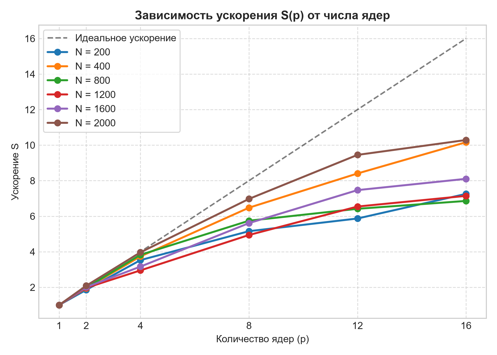
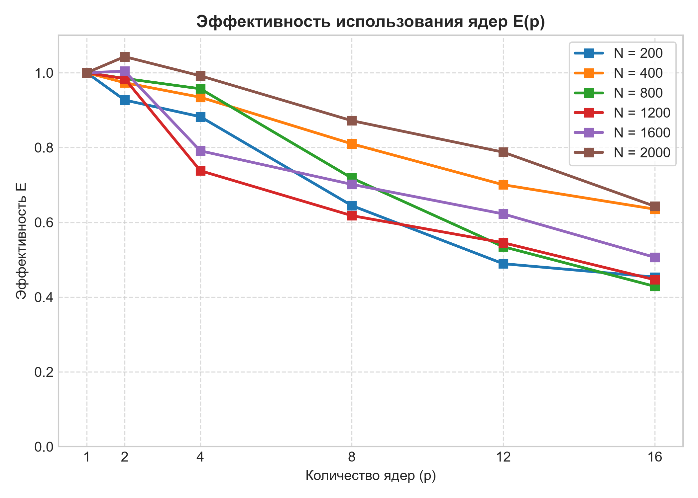
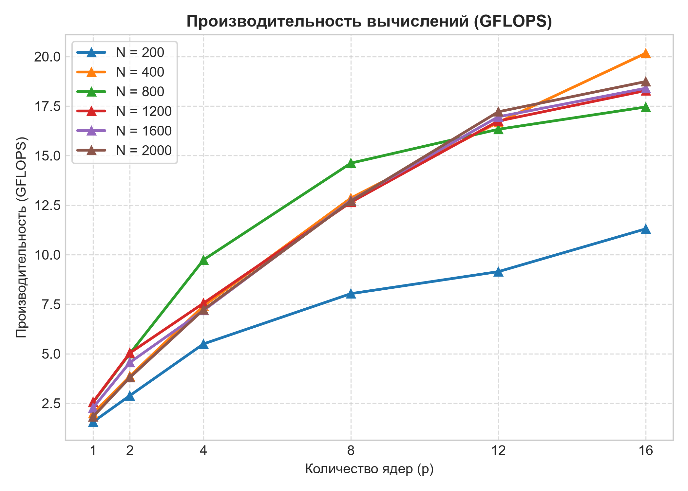

## Основные архитектурные и алгоритмические изменения кода

Для перевода последовательного алгоритма умножения матриц в параллельный с использованием библиотеки MPI были внесены следующие ключевые изменения:

### 1. Переход к одномерным сплошным массивам (Flattening)
* **Проблема:** Классическое представление матриц через `std::vector<std::vector<double>>` хранит строки в разных (разрозненных) участках оперативной памяти. Коллективные функции MPI (такие как `MPI_Bcast` и `MPI_Scatterv`) умеют пересылать данные по сети только одним непрерывным блоком памяти.
* **Решение:** Добавлена функция `flatten`, которая собирает все строки двумерной матрицы в один сплошной одномерный массив (`std::vector<double>` размером $N \times N$). Это позволило MPI мгновенно транслировать данные между узлами суперкомпьютера на аппаратном уровне.

### 2. Оптимизация дискового ввода/вывода (I/O)
* **Было:** Каждый процесс самостоятельно пытался открыть файлы матриц, прочитать их с диска, произвести расчет и записать результат обратно.
* **Стало:** Всеми дисковыми операциями теперь занимается **исключительно процесс с `Rank 0`**. Обычные рабочие процессы (`Rank 1, 2, 4...`) вообще не взаимодействуют с жестким диском.
* **Обоснование:** Если бы 16 процессов одновременно начали читать `matrixA.txt` и писать в `resultC.txt`, возникла бы жесткая конкуренция доступа («гонка за ресурс»). Общая дисковая система суперкомпьютера мгновенно превратилась бы в узкое горлышко (bottleneck), полностью уничтожив параллельное ускорение. Теперь `Rank 0` один раз считывает файлы в память и далее эффективно распределяет их по сети.

### 3. Ленточное разделение данных (Domain Decomposition)
Распределение вычислительной нагрузки построено по принципу **горизонтального ленточного разделения**:
* Матрица `B` отправляется всем ядрам целиком с помощью функции `MPI_Bcast`, так как каждому процессу необходим полный доступ ко всем её столбцам.
* Матрица `A` разрезается по строкам на «ленты» (блоки строк). Процесс `Rank 0` рассчитывает смещения и порции данных для каждого ядра индивидуально, после чего раздает уникальные ленты через функцию `MPI_Scatterv`. Например, при размере $N=1600$ и 4 ядрах каждое ядро получает строго по 400 строк.
* По окончании вычислений функция `MPI_Gatherv` производит обратную операцию — склеивает посчитанные локальные ленты `local_C` со всех процессов в единый результирующий массив `flat_C` на корневом узле.

### 4. Изменение границ циклов и схемы адресации
Вместо классического обхода всей матрицы $N \times N$, каждый процесс теперь обрабатывает исключительно свою порцию строк, используя линейную адресацию индексов (`идентификатор_строки * N + идентификатор_столбца`):

* **Было (последовательный код):**
  ```cpp
  for (int i = 0; i < n; ++i) { // Перебор ВСЕХ n строк матрицы А
      for (int k = 0; k < n; ++k) {
          double a = A[i][k];
          for (int j = 0; j < n; ++j) { C[i][j] += a * B[k][j]; }
      }
  }
  ```
* **Стало (локальный MPI-код на каждом ядре):**
  ```cpp
  for (int i = 0; i < local_rows; ++i) { // Перебор ТОЛЬКО СВОИХ выделенных строк
      for (unsigned int k = 0; k < n; ++k) {
          double a = local_A[i * n + k]; // Линейный доступ к ленте A
          for (unsigned int j = 0; j < n; ++j) {
              local_C[i * n + j] += a * flat_B[k * n + j]; // Накопление в локальную ленту C
          }
      }
  }
  ```

### 5. Точки синхронизации (MPI_Barrier)
В код внедрены явные барьеры `MPI_Barrier(MPI_COMM_WORLD)` перед началом распределения данных и сразу после сбора результатов. Это гарантирует, что таймер внутри `Rank 0` замеряет **чистое время параллельных вычислений**, исключая задержки, вызванные асинхронным стартом процессов или временем ожидания узлами друг друга.

---
## Графики

<p align="center">
  
  
  
</p>


## Анализ результатов и выводы

На основе полученных в ходе экспериментов данных сформированы следующие выводы:

### 1. Подтверждение эффективности распараллеливания (Speedup)
Параллельная программа демонстрирует стабильное масштабирование и падение времени выполнения при увеличении числа вычислительных ядер ($p$). 
* *Пример:* Для матрицы среднего размера ($N = 400$) время выполнения на одном ядре составляло **0.0645 сек**, а при использовании 16 ядер сократилось до **0.0063 сек**, что обеспечивает существенное ускорение расчетов.

### 2. Зависимость производительности (GFLOPS) от масштаба задачи
Пиковая производительность вычислительной системы напрямую зависит от вычислительной сложности задачи. При малых объемах данных ($N = 200$) накладные расходы на инициализацию MPI-сессии высоки, однако с ростом объема матриц эффективность вычислений резко возрастает. Максимальный показатель производительности зафиксирован на матрице размером $N = 400$ при использовании 16 вычислительных ядер и составил **20.1628 GFLOPS**.

### 3. Эффект насыщения
При анализе вычислений на матрицах больших размерностей ($N = 1200$ и $N = 1600$) четко прослеживается **эффект насыщения**. 
* *Пример:* На матрице $N = 1600$ переход с 12 ядер на 16 ядер приводит к крайне незначительному изменению времени: с **0.4831 сек** до **0.4452 сек**.

Данное явление демонстрирует классическое проявление накладных расходов в распределенных системах: с ростом числа участвующих ядер затраты времени на пересылку данных по сети (`MPI_Bcast` для трансляции всей матрицы `B` и `MPI_Scatterv`/`MPI_Gatherv` для распределения/сбора лент) начинают превышать времемя чистого вычисления матриц. Выделение дополнительных ядер перестает приносить линейный прирост скорости, так как система упирается в пропускную способность коммуникационной сети кластера.
