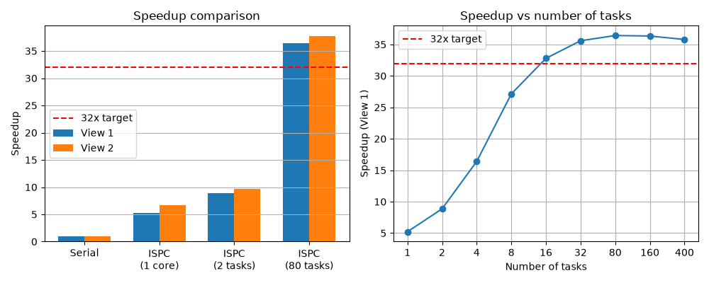

## Lab_5 (Program 3: Генерация фрактала Мандельброта на ISPC)

### Изменения в коде (`prog3_mandelbrot_ispc/mandelbrot.ispc`)

В функции `mandelbrot_ispc_withtasks` количество запускаемых задач увеличено с 2 до 80 для равномерной загрузки всех потоков процессора.

**Было:**
```c
uniform int rowsPerTask = height / 2;

// create 2 tasks
launch[2] mandelbrot_ispc_task(x0, y0, x1, y1,
                                 width, height,
                                 rowsPerTask,
                                 maxIterations,
                                 output);
```

**Стало:**
```c
uniform int numTasks = 80;
uniform int rowsPerTask = height / numTasks;

// create 80 tasks
launch[numTasks] mandelbrot_ispc_task(x0, y0, x1, y1,
                                        width, height,
                                        rowsPerTask,
                                        maxIterations,
                                        output);
```

---

### Сборка и запуск

Для компиляции и замера времени на обоих ракурсах (View 1 и View 2) использовались следующие команды:

```bash
cd prog3_mandelbrot_ispc
make
./mandelbrot_ispc --tasks
./mandelbrot_ispc --tasks --view 2
```

### Результаты замеров

| Версия программы | View 1: Время (мс) | View 1: Ускорение | View 2: Время (мс) | View 2: Ускорение |
| :--- | :---: | :---: | :---: | :---: |
| **Serial (обычный C++)** | 257.89 | 1.00x | 149.11 | 1.00x |
| **ISPC (без задач, 1 ядро)** | 49.51 | 5.21x | 22.42 | 6.65x |
| **ISPC Tasks (2 задачи)** | 29.10 | 8.86x | 15.41 | 9.68x |
| **ISPC Tasks (80 задач)** | **7.08** | **36.43x** | **3.95** | **37.75x** |



### Часть 1. Векторизация на одном ядре (`mandelbrot_ispc`)

1. **Какое максимальное ускорение ожидается:**  
   Теоретический максимум — **8.0x**. Компилятор ISPC использует векторные инструкции AVX2, которые за один такт обрабатывают сразу 8 чисел `float` вместо одного.
2. **Почему на практике получилось меньше (5.21x и 6.65x):**  
   Все 8 пикселей в одном векторном регистре считаются одновременно и обязаны выполнять одни и те же шаги. На границах фрактала соседние пиксели требуют разного числа итераций цикла `while`. Пиксели, которые закончили расчет раньше, просто отключаются по маске и ждут, пока досчитается самый «долгий» пиксель из восьмерки. Из-за этого часть вычислительных линий простаивает (*SIMD divergence*).
3. **Почему на View 2 ускорение выше, чем на View 1:**  
   На View 1 много резких переходов между «быстрым» фоном и «долгой» черной областью в центре, поэтому соседи в восьмерках часто заканчивают работу в разное время. На View 2 сложность пикселей распределена более равномерно, и векторные регистры загружены лучше (6.65x против 5.21x).

### Часть 2. Многопоточность через задачи (`mandelbrot_ispc --tasks`)

1. **Что получилось при запуске 2 задач (`launch[2]`):**  
   * Ускорение на View 1 составило **8.86x** по сравнению с обычным C++ кодом.
   * Относительно одноядерной ISPC-версии ускорение вышло всего **1.70x** (`49.51 / 29.10`).
   * *Причина:* у процессора 4 ядра (8 потоков), а 2 задачи могут занять максимум два из них — остальные ядра простаивают. Кроме того, верхняя и нижняя части картинки считаются за разное время, поэтому один поток заканчивает раньше другого.
2. **Как удалось получить ускорение больше 32x (`numTasks = 80`):**  
   * В функции `mandelbrot_ispc_withtasks()` число задач увеличено с 2 до **80**.
   * **Почему выбрано число 80:** высота картинки равна `800` пикселей, а в функции `mandelbrot_ispc_task` нет проверки на выход за границы массива. Поэтому число задач должно делить `800` без остатка. `800 / 80 = 10` строк на задачу — это дает по 10 задач на каждый из 8 потоков процессора и гарантирует отсутствие ошибок памяти.
   * **Почему это работает:** мелкие задачи хорошо выравнивают нагрузку. Как только поток быстро доделывает «легкую» полосу с краю картинки, планировщик ISPC сразу выдает ему следующую задачу из очереди. Все 8 потоков работают без простоев до конца, что дает ускорение **36.43x** на View 1 и **37.75x** на View 2.

### Вывод: Потоки ОС против задач ISPC

1. **В чем разница:**  
   * `std::thread` создает полноценный поток операционной системы со своим стеком (несколько мегабайт) и контекстом. Переключением таких потоков управляет ядро ОС.
   * `launch` в ISPC не создает новые потоки ОС. Он просто кладет легкое описание задачи в очередь, которую разгребает заранее запущенный пул из 8 рабочих потоков. Вызов `sync` просто ждет, пока очередь опустеет.
2. **Что будет, если запустить 10 000 потоков против 10 000 задач:**  
   * **10 000 потоков ОС:** программа сильно затормозит или упадет с нехваткой памяти. Под стеки уйдут гигабайты RAM, а процессор будет тратить почти все время на тяжелые переключения контекста в ОС и очистку кэшей вместо полезных расчетов.
   * **10 000 задач ISPC:** отработают быстро и без проблем. Они займут меньше мегабайта памяти в очереди, а 8 рабочих потоков спокойно разберут их один за другим без лишних затрат на переключение в ОС.
